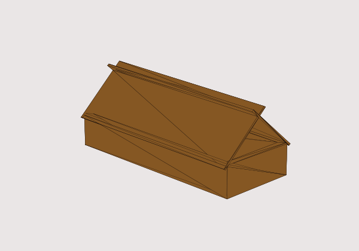
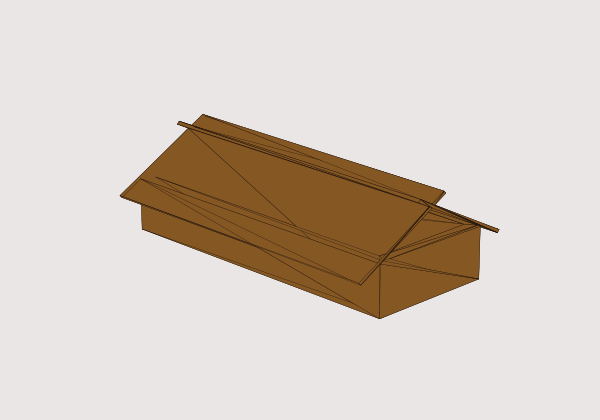
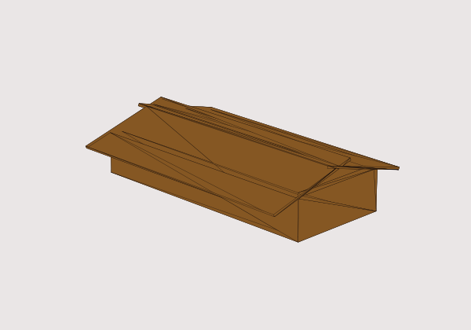
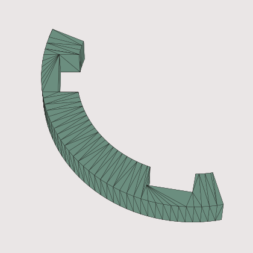
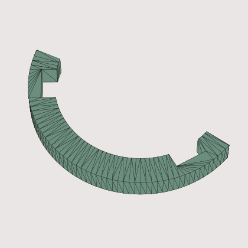

# 爪楊枝アート作成支援システム

爪楊枝を井桁状に組んで作る「家型オブジェ」の設計と制作を支援する Python 製ツールです。学部の卒業研究で開発しました。

GUI で家の形(屋根角度・高さ・奥行き)を指定すると、完成形を 3D プレビューで確認でき、爪楊枝の位置と角度を保持する **3D プリンタ用サポータ(STL)を自動生成**します。組み立て手順は動画で案内されます。

## 背景

爪楊枝アートは、図面を爪楊枝の集合に置き換える設計力と、接着剤が固まるまで間隔を保つ精密な手作業が必要で、初心者には難しい作品です。
そこで「**設計と位置の保持は計算機とサポータが担い、人間は組み立てに専念する**」という役割分担で、初心者でも再現性高く作れるようにしました。

## 主な機能

- **設計用 GUI**: 屋根角度・高さ・奥行きをスライダーで指定し、3D プレビューを視点を変えながら確認できます。
- **家型モデルの生成**: 指定値から壁と屋根のメッシュを [trimesh](https://trimesh.org/) で組み立てて STL にします。屋根は爪楊枝 2 本の交差を二等辺三角形として扱い、家の幅に合う高さを幾何計算で求めています。
- **サポータの生成**: 屋根の角度に合わせて形が変わる「ワッシャ型サポータ」を STL として出力します。使わない部分を削ることで、印刷時間を約 47% 短縮できました(Bambu Lab 純正スライサーでの測定)。
- **組み立て用 GUI**: 設計を確定すると手順動画の画面に切り替わり、動画の切り替えと再生速度の変更ができます。

| 屋根 80° | 屋根 110° | 屋根 140° |
|:---:|:---:|:---:|
|  |  |  |

屋根角度ごとに形が変わるワッシャ型サポータ(左:80°、右:120°)

| 80° | 120° |
|:---:|:---:|
|  |  |

## 評価

研究室の大学院生 2 名・学部生 4 名の計 6 名に、設計から製作までを行ってもらいました。

- 6 名全員が、屋根の交差部を含む家を製作できました。
- 「容易に設計できると思うか」(4 段階): 4 が 4 名、3 が 2 名でした。
- 「素手で作るより早く作れると思うか」(4 段階): 4 が 5 名、2 が 1 名でした。

## 使い方

Windows 環境で開発しています。

### 必要なもの

- Python 3.12 と、次のライブラリ

  ```
  pip install flet flet-video trimesh manifold3d numpy-stl matplotlib
  ```

  numpy は他のライブラリが依存して入れるので、単独でバージョンを変えないでください。
- 3D プリンタ
- 爪楊枝(長さ 65mm のもの)と接着剤。研究ではグルーガンを使いました。

### 手順

1. このリポジトリをダウンロードします。
2. 共通のサポータ部品 `assets/AiO1218.3mf` を印刷します。
3. `python windowMaker.py` で GUI を起動します。
4. 屋根角度・高さ・奥行きを指定し、「プレビュー作成」で形を確認します。
5. 形が決まったら「ダウンロード・組み立て操作へ」を押します。`supporter/` にワッシャ型サポータ `washer<角度>.stl` が出力され、手順動画の画面に切り替わります。
6. `supporter/washer<角度>.stl` を印刷します。
7. 動画の手順に沿って、爪楊枝を組み立てます。

## ファイル構成

| ファイル | 内容 |
|---|---|
| `windowMaker.py` | GUI(設計用・組み立て用)。Flet で実装。 |
| `STLMaker.py` | 家型モデルの生成と STL 出力。屋根の高さ計算もここ。 |
| `crossplate.py` | 屋根板の生成。 |
| `supporter_generator.py` | ワッシャ型サポータの生成。 |
| `mpl_previewer.py` | STL を matplotlib で描画し、GUI に埋め込む PNG にする。 |
| `assets/` | 共通サポータの 3mf、デモ用 STL、手順動画 5 本。 |

## 使用ライブラリ

[Flet](https://flet.dev/)(GUI)、[trimesh](https://trimesh.org/)(3D メッシュ)、[manifold3d](https://github.com/elalish/manifold)(メッシュの差・和)、[numpy-stl](https://github.com/WoLpH/numpy-stl) と [Matplotlib](https://matplotlib.org/)(プレビュー描画)

## ライセンス

[MIT License](LICENSE)
